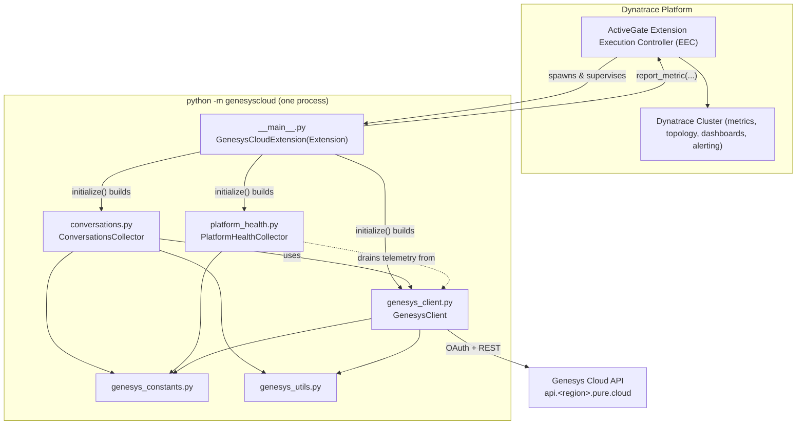
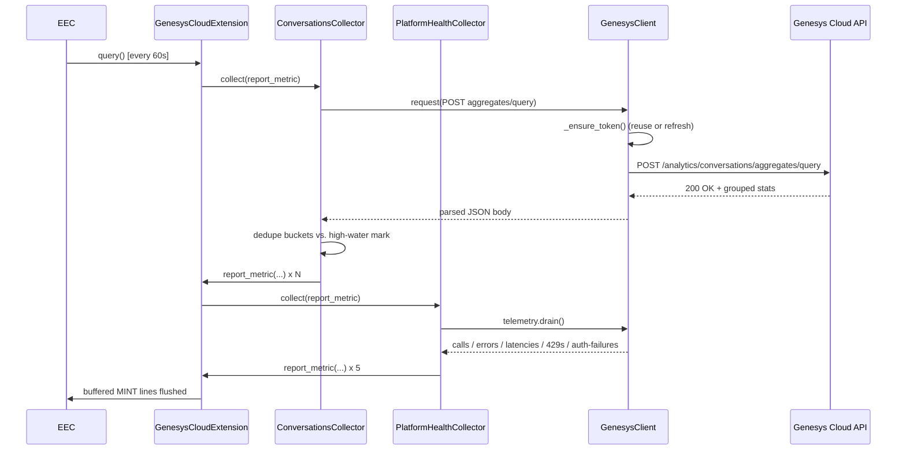
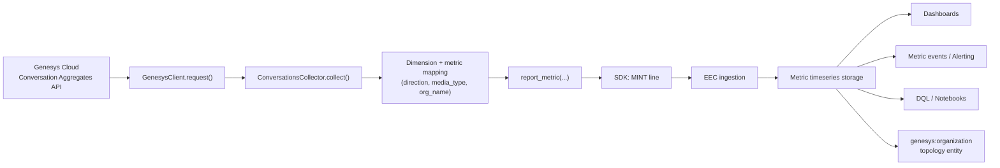
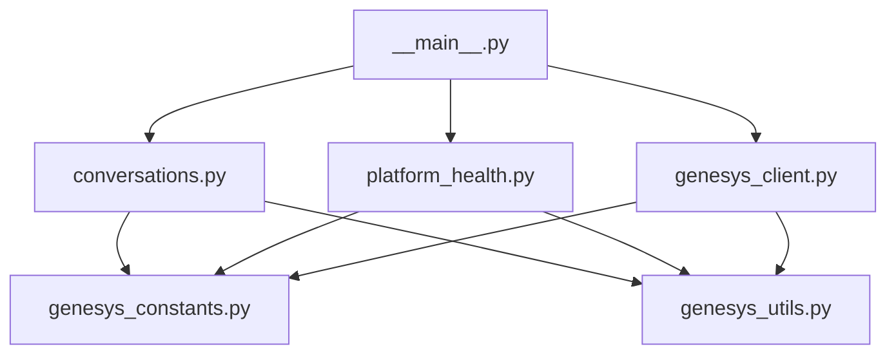

# Genesys Cloud — Dynatrace Extension 2.0

> **Status:** Phase 0 (Platform Health) and Phase 1 (Conversation Analytics) are implemented and production-ready. Built on the Dynatrace Extension Framework 2.0 (EF2) Python data source model, and intentionally structured so future phases (queues, users, routing, wrap-up codes, ...) can be added without redesigning the architecture.

---

## Table of Contents

1. [Project Overview](#1-project-overview)
2. [Current Implementation Status](#2-current-implementation-status)
3. [Phase 1 — Conversation Analytics](#3-phase-1--conversation-analytics)
4. [Design Decision: Aggregates API vs. Analytics Jobs API](#4-design-decision-aggregates-api-vs-analytics-jobs-api)
5. [Overall Execution Flow](#5-overall-execution-flow)
6. [Repository Structure](#6-repository-structure)
7. [Code Execution Flow](#7-code-execution-flow)
8. [Conversation Aggregates API](#8-conversation-aggregates-api)
9. [Metrics Collected](#9-metrics-collected)
10. [Dimensions](#10-dimensions)
11. [Why Conversation IDs Were Not Collected](#11-why-conversation-ids-were-not-collected)
12. [Entity Model](#12-entity-model)
13. [Metric Flow](#13-metric-flow)
14. [Extension Configuration](#14-extension-configuration)
15. [Error Handling](#15-error-handling)
16. [Logging](#16-logging)
17. [Future Roadmap](#17-future-roadmap)
18. [Architecture Diagrams](#18-architecture-diagrams)

---

## 1. Project Overview

### Purpose

This extension gives Dynatrace operational visibility into a **Genesys Cloud** contact centre. It is a Python data source extension built on **Dynatrace Extension Framework 2.0 (EF2)**, packaged as `custom:genesyscloud`.

### Why Dynatrace is monitoring Genesys Cloud

Genesys Cloud is an external, vendor-hosted contact-centre platform. From Dynatrace's perspective it is a **third-party dependency**: when it is slow, unreachable, or rate-limiting the integration, that should show up in Dynatrace the same way a degraded database or downstream API would. At the same time, the business wants operational KPIs (call volume, handle time, wait time) visible alongside the rest of the observability stack, not in a separate Genesys-only dashboard.

This extension answers two distinct questions:

1. **Is the integration healthy?** (Phase 0 — Platform Health) — API latency, call volume, errors, auth failures, and rate-limiting, as observed by the extension itself while talking to Genesys.
2. **What is happening with conversations?** (Phase 1 — Conversation Analytics) — inbound/outbound volume and the core duration KPIs (handle, talk, wait, hold, after-call work), broken down by direction and media type.

### High-level architecture

The extension runs as a single Python process (`python -m genesyscloud`), launched and supervised by the Dynatrace ActiveGate's Extension Execution Controller (EEC). It holds one shared, authenticated HTTP client to the Genesys Cloud API, and two independent **collectors** — one per phase — that use that client to gather and report metrics every 60 seconds. See [§18](#18-architecture-diagrams) for diagrams.

### Supported features

- Two feature sets (`platform_health`, `conversations`), independently toggled per monitoring configuration.
- Shared, resilient Genesys API client: OAuth2 client-credentials grant, token caching/refresh, retry with exponential backoff, HTTP 429 (`Retry-After`) handling, pagination helper, and DNS-failure detection.
- Self-monitoring: Phase 0 reports on the extension's own API health so the integration itself can be alerted on.
- Cardinality-safe metric design: only low-cardinality dimensions are ever emitted (see [§11](#11-why-conversation-ids-were-not-collected)).
- One declarative topology entity (`genesys:organization`), derived entirely from metric dimensions — no entity-creation code.
- SDK-controlled lifecycle: no custom scheduler or event loop; the SDK calls `query()` every 60 seconds.

---

## 2. Current Implementation Status

The extension is being built in phases, each adding one feature set and (usually) one collector module, without altering the core client/lifecycle code.

| Phase | Scope | Status |
|---|---|---|
| **Phase 0** | Platform Health (self-monitoring of the Genesys API integration) | ✅ Completed |
| **Phase 1** | Conversation Analytics (volume + duration KPIs via Aggregates API) | ✅ Completed |
| Phase 2+ | Queues, Users/Presence, Routing, Wrap-up Codes, Contact Lists, other Genesys services | Not implemented — logical next candidates, see [§17](#17-future-roadmap) |

Only Phase 0 and Phase 1 exist in code today (`genesys_client.py`, `genesys_constants.py`, `genesys_utils.py`, `conversations.py`, `platform_health.py`, `__main__.py`). No other collector modules ship in this release.

---

## 3. Phase 1 — Conversation Analytics

### What was implemented

`ConversationsCollector` (`genesyscloud/conversations.py`) queries the Genesys **Conversation Aggregates API** once per collection cycle and reports:

- Total, inbound, and outbound conversation counts (`nOffered`).
- Average handle, talk, hold, wait, and after-call-work (ACW) durations.

Each metric is broken down by `direction` and `media_type` — the two dimensions requested via `groupBy` in the API call.

### Why conversation analytics was selected first

Conversation volume and duration are the most universally understood contact-centre health signals — they map directly to staffing, SLA, and customer-experience concerns that an operations team already monitors. They also exercise the full integration surface (OAuth, retries, pagination-free aggregation, rate limiting) with a single well-understood API, making Phase 1 a solid foundation to build later phases on without revisiting the client.

### Why aggregated operational metrics, not individual conversation records

Dynatrace's metric model (MINT lines, timeseries, dimensions) is built for **aggregated, low-cardinality operational data** — the same model used for request counts, error rates, and latencies elsewhere in Dynatrace. Individual conversation records are high-cardinality, transactional data that belongs in a log or data-warehouse system, not a metrics timeseries. Reporting pre-aggregated `count`/`sum` statistics per `(direction, mediaType)` group, rather than one data point per conversation:

- Keeps metric cardinality bounded and predictable regardless of contact-centre size.
- Lets metrics be charted, alerted on, and queried with DQL exactly like any other Dynatrace metric.
- Matches what the Genesys Aggregates API itself returns — no client-side aggregation of raw records is needed (see [§4](#4-design-decision-aggregates-api-vs-analytics-jobs-api)).

### Operational insights provided

- **Volume trends**: are inbound/outbound conversation volumes rising, falling, or anomalous for the time of day?
- **Service quality**: is wait time creeping up (under-staffing, queue backlog) or is handle time abnormally long (process or agent issue)?
- **Channel mix**: how does the workload (and its duration profile) differ between voice, chat, email, message, and callback?
- **After-call work**: is ACW time consuming so much agent capacity that it is effectively reducing available headcount?

---

## 4. Design Decision: Aggregates API vs. Analytics Jobs API

This is the most important architectural decision in the extension, and it is encoded directly in `genesys_constants.py`:

```python
# API paths (Aggregates APIs only)
PATH_CONVERSATION_AGGREGATES = "/api/v2/analytics/conversations/aggregates/query"
PATH_QUEUE_AGGREGATES = "/api/v2/analytics/queues/aggregates/query"  # reserved for Phase 2
```

and the accompanying comment: *"Analytics Jobs APIs are deliberately not used — they are for bulk conversation-level exports, not periodic metric collection."*

### The rejected approach: Analytics Jobs API

Genesys Cloud's `POST /api/v2/analytics/conversations/details/jobs` is an **asynchronous, job-based** export API:

1. `POST .../details/jobs` — create a job, describing the query.
2. Receive a job ID (no data yet).
3. Poll `GET .../details/jobs/{jobId}` repeatedly until the job state becomes `FULFILLED`.
4. `GET .../details/jobs/{jobId}/results` — download the (potentially large) result set of individual conversation-detail records.

This pattern is well suited to bulk historical exports, but is a poor fit for a Dynatrace extension that must run a **complete collection cycle every 60 seconds**:

- **Multiple API calls per cycle** — at minimum create + poll(s) + download, versus a single call for the aggregate query.
- **Polling overhead and unpredictable completion time** — job fulfillment time is not guaranteed, so the extension would need to either block (risking missed/overlapping cycles) or carry job state across cycles (added complexity for no operational benefit).
- **Risk of timeout** — if a job is not fulfilled before the next 60-second cycle starts, the extension must decide whether to abandon it, queue another, or fall behind; none of these are good options for a metrics collector.
- **Job lifecycle management** — jobs must be tracked, and abandoned/failed jobs must be cleaned up or at least ignored; this is bookkeeping the extension would own for no metrics-quality benefit.
- **Higher API consumption** — each cycle would consume a job-create call, one or more poll calls, and a results-download call, multiplying API usage many times over against the Genesys org's API quota.
- **Returns individual records, not aggregates** — the extension would then have to perform its own client-side aggregation (grouping, summing, averaging) of potentially large detail-record payloads every cycle, duplicating logic the Aggregates API already provides server-side.

### The chosen approach: Conversation Aggregates API

`POST /api/v2/analytics/conversations/aggregates/query` (used in `ConversationsCollector.collect()`, `genesyscloud/conversations.py`) is **synchronous**: one request, one response, already aggregated by Genesys into `groupBy`'d buckets with `count`/`sum` statistics per requested metric.

Advantages for a 60-second-cadence extension:

- **Single API request** per collection cycle — no job creation, no follow-up calls.
- **Immediate response** — no polling, no unbounded wait, fits comfortably inside the 60-second query budget.
- **No job IDs or job-state tracking** — nothing to manage between cycles beyond the bucket-deduplication high-water mark already needed for correctness (see [§8](#8-conversation-aggregates-api)).
- **Lower API usage** — one call per metric group per cycle, versus job create + N polls + download.
- **Server-side aggregation** — Genesys returns pre-grouped `count`/`sum` stats; the extension only needs to map fields, not aggregate raw records.
- **Lower complexity, higher reliability** — fewer network round-trips means fewer failure points, and the collector's retry/backoff logic (already in `GenesysClient`) covers the entire operation with one consistent code path.
- **Better performance** — a single request completes in roughly one round-trip's latency, versus the Jobs API's create-then-poll-then-download chain.

In short: the Jobs API is the right tool for bulk historical export; the Aggregates API is the right tool for periodic operational metrics. This extension only ever needs the latter.

---

## 5. Overall Execution Flow

```
Extension process starts (python -m genesyscloud)
        │
        ▼
Dynatrace SDK constructs GenesysCloudExtension(Extension)
        │   SDK parses --dsid/--url/--idtoken (or local sim args),
        │   fetches the activation config + feature-set map from the EEC
        ▼
SDK calls initialize() [once]
        │   _read_config() reads region / clientId / clientSecret / orgName
        │   GenesysClient(region, clientId, clientSecret) constructed
        │   org_name resolved (orgName, falling back to region if blank)
        │   ConversationsCollector + PlatformHealthCollector constructed,
        │   sharing the one GenesysClient instance
        ▼
SDK schedules query() to run every 60 seconds
        │
        ▼
Each cycle: query() runs
        │
        ├─▶ ConversationsCollector.collect(report)
        │       │  builds a 15-minute query window, offset 5 minutes into the past
        │       │  POST /analytics/conversations/aggregates/query  (OAuth token ensured first)
        │       │  parses grouped stats, dedupes against the high-water mark
        │       │  report_metric(...) for each direction/mediaType group + the org total
        │       ▼
        │   (failure here is caught and logged; does not abort the cycle)
        │
        ├─▶ PlatformHealthCollector.collect(report)
        │       │  drains GenesysClient.telemetry (the calls Phase 1 just made)
        │       │  report_metric(...) for latency / calls / errors / auth-failures / 429s
        │       ▼
        │   (failure here is caught and logged independently)
        │
        ▼
SDK flushes buffered report_metric(...) calls as MINT lines to the EEC
        │
        ▼
EEC forwards metrics to the Dynatrace cluster; topology engine attaches
genesys:organization entity from the org_name dimension
        │
        ▼
Cycle complete; SDK sleeps until the next 60-second tick
```

A separate, much shorter flow runs **once**, before activation is accepted: `fastcheck()` builds a throw-away `GenesysClient` and forces an OAuth token request (`_ensure_token()`) to confirm the region and credentials are valid, without running a full collection cycle. See [§15](#15-error-handling).

---

## 6. Repository Structure

```
GenesysCloud/
├── activation.json                # Local-simulator activation config (dt-sdk run); not used in production
├── secrets.json                   # Local-only secret values referenced by activation.json (never committed)
├── setup.py                       # Python packaging metadata; version is read from extension.yaml
├── README.md                      # This document
├── extension/
│   ├── extension.yaml             # Metric metadata, feature sets, topology, python runtime config
│   ├── activationSchema.json      # Configuration UI schema (region/clientId/clientSecret/orgName)
│   └── lib/                       # Wheels bundled into the signed extension zip (dt-sdk build output)
└── genesyscloud/                  # The installed Python package; entry point for `python -m genesyscloud`
    ├── __init__.py
    ├── __main__.py                 # SDK Extension subclass + process entry point
    ├── genesys_client.py           # Shared, authenticated HTTP client
    ├── genesys_constants.py        # Single source of truth: regions, paths, metric/dimension keys, tunables
    ├── genesys_utils.py            # Pure helper functions + logger factory (no HTTP, no SDK coupling)
    ├── conversations.py            # Phase 1 collector
    └── platform_health.py          # Phase 0 collector
```

There is no `requirements.txt` or `pyproject.toml`; `setup.py` is the single source of dependency metadata, consumed both by local `pip install .` and by `dt-sdk build` when it resolves wheels into `extension/lib/`. There is no separate topology file — the `genesys:organization` entity type is declared inline inside `extension/extension.yaml` under the `topology:` key.

### File-by-file

#### `genesyscloud/__main__.py`
**Purpose:** the SDK-controlled entry point. Defines `GenesysCloudExtension(Extension)` and the `main()` function invoked by `python -m genesyscloud`.
**Responsibilities:** build the shared client and collectors once (`initialize()`); run both collectors every cycle (`query()`); validate credentials quickly before activation (`fastcheck()`); release resources on shutdown (`on_shutdown()`); read and validate activation configuration (`_read_config()`); respect the EEC's enabled-feature-set map (`_enabled()`).
**Depends on:** `dynatrace_extension` (the SDK), `genesys_client.GenesysClient`/`GenesysAuthError`, `conversations.ConversationsCollector`, `platform_health.PlatformHealthCollector`.
**Why it exists:** this is the only file the SDK lifecycle (`Extension` base class) talks to directly. Keeping it thin and delegating real work to collectors means the lifecycle contract (`initialize`/`query`/`fastcheck`/`on_shutdown`) never has to change as new phases are added.

#### `genesyscloud/genesys_client.py`
**Purpose:** owns every HTTP concern so collectors never make raw requests.
**Responsibilities:** OAuth2 client-credentials grant and token caching/refresh (`_ensure_token`); authenticated request execution with retry, exponential backoff, HTTP 401/429/5xx handling, and DNS-failure detection (`request`); pagination over the standard `entities`/`pageCount` envelope (`get_paginated`); per-cycle telemetry counters (`CallTelemetry`) that Phase 0 drains.
**Depends on:** `requests`, `genesys_constants` (regions, paths, retry tunables), `genesys_utils.get_logger`.
**Interacts with:** every collector holds a reference to the single shared instance constructed in `__main__.initialize()`; `PlatformHealthCollector` reads (and resets) its `telemetry` attribute.
**Why it exists:** centralizing HTTP concerns means every phase automatically inherits consistent auth, retry, and rate-limit handling, and Phase 0 can self-monitor the *real* calls other phases make without instrumenting each collector separately.

#### `genesyscloud/genesys_constants.py`
**Purpose:** the single source of truth for region hosts, API paths, metric/dimension keys, and HTTP tunables.
**Responsibilities:** `REGIONS` (login/API hostnames per Genesys region); API paths (token, conversation aggregates, reserved queue aggregates); feature-set identifiers; metric key constants (`M_*`); the Genesys-side aggregate field list (`GENESYS_CONV_METRICS`) and its mapping to metric keys (`CONV_DURATION_MAP`); the query-window tunables (`CONV_AGGREGATE_LAG_MINUTES`, `CONV_QUERY_WINDOW_MINUTES`); dimension key constants (`DIM_*`); HTTP behaviour constants (timeout, retries, backoff base, token refresh skew, page size).
**Why it exists:** every other module imports from here instead of hard-coding strings, so `extension.yaml`'s metric keys, the collectors' reported metric keys, and the client's API paths can never silently drift apart.

#### `genesyscloud/genesys_utils.py`
**Purpose:** pure, side-effect-free helper functions and the logger factory. Explicitly has no HTTP code and no SDK coupling, so it can be unit-tested or reused without either dependency.
**Responsibilities:** `get_logger(name)` — namespaced `genesys.<name>` child logger with `INFO` level explicitly set (see [§16](#16-logging)); `utc_now()`; `last_full_minute_interval(lookback_minutes, offset_minutes)` — builds the ISO-8601 interval string the Aggregates API expects; `stat(stats, key, default)` — safely reads a numeric value out of a Genesys stats block; `ms_to_seconds()`; `safe_div()` — a defensive division helper available for future collectors (not currently called by Phase 0/1).
**Why it exists:** keeps date/interval math and defensive parsing out of the collectors, where it would otherwise be duplicated per phase.

#### `genesyscloud/conversations.py`
**Purpose:** Phase 1 collector. See [§3](#3-phase-1--conversation-analytics) and [§8](#8-conversation-aggregates-api) for full behaviour.
**Depends on:** the shared `GenesysClient` (passed in, never constructed here), `genesys_constants`, `genesys_utils`, `dynatrace_extension.MetricType`.
**Interacts with:** instantiated once in `__main__.initialize()`; invoked once per cycle from `__main__.query()`.

#### `genesyscloud/platform_health.py`
**Purpose:** Phase 0 collector — self-monitoring. See [§9](#9-metrics-collected).
**Responsibilities:** makes **no API calls of its own**; instead it drains `GenesysClient.telemetry` (calls/errors/latencies/429s/auth-failures accumulated by whichever other collector(s) used the client this cycle) and reports them as metrics.
**Depends on:** the shared `GenesysClient`'s `telemetry` attribute, `genesys_constants`, `genesys_utils`, `dynatrace_extension.MetricType`.
**Why it exists as a separate phase:** it lets operators alert on the *integration's* health (auth, latency, rate limiting) independently of whether any particular business metric (like conversation volume) happens to be zero.

#### `extension/extension.yaml`
**Purpose:** the EF2 extension manifest — the contract between this Python code and the Dynatrace platform.
**Responsibilities:** declares every metric's metadata (display name, description, unit, dimensions, tags); declares the `genesys:organization` topology type and its derivation rule; declares the Python runtime (`module: genesyscloud`, minimum Python `3.10`); points to `activationSchema.json` for both local and remote activation; declares the two feature sets and which metrics belong to each.
**Why it exists:** EF2 extensions are validated and assembled from this manifest; metric keys declared here **must** match `genesys_constants.py`'s `M_*` constants exactly, or metrics reported by the collectors will be silently rejected by the EEC.

#### `extension/activationSchema.json`
**Purpose:** defines the configuration UI shown when creating a monitoring configuration (region, OAuth client ID/secret, organization label).
**Responsibilities:** defines the `genesys-connection` object type (`region`, `clientId`, `clientSecret`, `orgName`) and nests it under a `genesys` key for both `pythonLocal` and `pythonRemote` activation contexts; enforces field-level constraints (e.g. length, nullability).
**How it's consumed:** `__main__._read_config()` reads `activation_config.config["genesys"]` (falling back to the config root for resilience) to populate the values the SDK passes to `GenesysClient`.

#### `setup.py`
**Purpose:** Python packaging metadata for both `pip install .` (local development) and `dt-sdk build` (CI/release).
**Responsibilities:** declares `install_requires` (`dt-extensions-sdk`, `requests`); reads the package version dynamically from `extension/extension.yaml` so the two files can never report different versions.

#### `activation.json`
**Purpose:** used only by the local simulator (`dt-sdk run`); defines a sample monitoring configuration (region, OAuth credentials via `secrets.json` placeholders, `orgName`) so the extension can be exercised without a real Dynatrace tenant.

---

## 7. Code Execution Flow

Runtime call sequence for one collection cycle, traced through the actual function calls:

```
genesyscloud/__main__.py : main()
        │
        ▼
GenesysCloudExtension().run()                         (dynatrace_extension.Extension base class)
        │   SDK parses args, fetches activation config + feature sets from the EEC,
        │   calls initialize() once, then schedules query() every 60s
        ▼
GenesysCloudExtension.query()
        │
        ├──▶ self._enabled(self.conversations.feature_set)  →  True/False from enabled_feature_sets map
        │       │
        │       ▼ (if enabled)
        │   ConversationsCollector.collect(self.report_metric)
        │       │
        │       ├─▶ genesys_utils.last_full_minute_interval(15, 5)   → interval string
        │       ├─▶ GenesysClient.request("POST", PATH_CONVERSATION_AGGREGATES, json_body={...})
        │       │       ├─▶ GenesysClient._ensure_token()             → cached or freshly fetched OAuth token
        │       │       └─▶ requests.Session.request(...)             → HTTP call to Genesys, with retry/backoff
        │       ├─▶ ConversationsCollector._aggregate_new_buckets(...)  → dedupe + sum stats per group
        │       ├─▶ ConversationsCollector._emit_avg_seconds(...)       → per-duration-field gauge reports
        │       └─▶ report_metric(...)  →  buffered by the SDK for this cycle
        │
        └──▶ self._enabled(self.platform_health.feature_set)
                │
                ▼ (if enabled)
            PlatformHealthCollector.collect(self.report_metric)
                │
                ├─▶ GenesysClient.telemetry.drain()   → calls/errors/latencies/429s/auth-failures, then reset
                └─▶ report_metric(...)  ×5             →  buffered by the SDK for this cycle
        │
        ▼
SDK serializes all buffered report_metric(...) calls into MINT lines and sends them to the EEC
```

Each `collect()` call is wrapped in its own `try`/`except` inside `query()`, so an exception in one phase (e.g. Genesys returning a malformed payload) is logged and does not prevent the other phase from reporting in the same cycle.

---

## 8. Conversation Aggregates API

### Endpoint

```
POST /api/v2/analytics/conversations/aggregates/query
```

(`genesys_constants.PATH_CONVERSATION_AGGREGATES`, called from `ConversationsCollector.collect()`.)

### Request payload

```json
{
  "interval": "2026-06-26T09:45:00.000Z/2026-06-26T10:00:00.000Z",
  "granularity": "PT1M",
  "groupBy": ["direction", "mediaType"],
  "metrics": ["nOffered", "tHandle", "tTalk", "tHeld", "tAcw", "tWait"]
}
```

- **GroupBy values**: `direction` (e.g. `inbound`, `outbound`) and `mediaType` (e.g. `voice`, `chat`, `email`, `message`, `callback`). These are the only two `groupBy` dimensions requested.
- **Metrics requested** (`genesys_constants.GENESYS_CONV_METRICS`): `nOffered` (offered count), `tHandle` (handle time), `tTalk` (talk time), `tHeld` (hold time), `tAcw` (after-call work time), `tWait` (ACD wait time). All duration fields are in **milliseconds**.
- **Granularity**: always `PT1M` (one-minute buckets) — independent of the outer window width, this is what lets the collector deduplicate at minute resolution.
- **Time interval**: computed by `genesys_utils.last_full_minute_interval(lookback_minutes=CONV_QUERY_WINDOW_MINUTES, offset_minutes=CONV_AGGREGATE_LAG_MINUTES)`:
  - `CONV_QUERY_WINDOW_MINUTES = 15` — the width of the queried window. This is deliberately **wider** than the 60-second collection cadence.
  - `CONV_AGGREGATE_LAG_MINUTES = 5` — the window's end is shifted 5 minutes into the past, because Genesys's conversation-aggregate finalization lags real time; querying the most recently closed minute frequently returns no data yet.
  - Net effect: every cycle queries roughly `[now − 20 min, now − 5 min)`, at one-minute granularity, i.e. up to 15 one-minute buckets per `groupBy` group.

### Expected response structure

```json
{
  "results": [
    {
      "group": { "direction": "inbound", "mediaType": "voice" },
      "data": [
        {
          "interval": "2026-06-26T09:50:00.000Z/2026-06-26T09:51:00.000Z",
          "metrics": [
            { "metric": "nOffered", "stats": { "count": 12 } },
            { "metric": "tHandle", "stats": { "count": 12, "sum": 1452000 } }
          ]
        }
      ]
    }
  ]
}
```

### How the response is parsed (and why it overlaps cycles safely)

Because the query window (15 minutes) is much wider than the collection cadence (60 seconds), the **same one-minute bucket appears in many consecutive cycles' responses** until it ages out of the window. `ConversationsCollector` deduplicates this with a high-water mark:

- `self._last_reported_end` tracks the end-timestamp of the newest per-minute bucket already folded into a previous report.
- On each `collect()` call, `_aggregate_new_buckets()` walks every `data` bucket per group and **skips any bucket whose end-time is at or before that mark** (`_bucket_end(data_point) <= since`).
- Buckets strictly newer than the mark are summed into per-metric `count`/`sum` totals for that group, and the mark is advanced to the newest bucket end seen.
- On the very first call after a restart, the mark defaults to the interval's start, so the extension absorbs up to the full 15-minute backlog in one cycle — this avoids losing data immediately after the extension (re)starts, at the cost of one larger-than-usual report on the first cycle only.

This is what makes it safe to report `nOffered`-derived counts as **DELTA** metrics (summed by Dynatrace over a timeframe) despite querying an overlapping window every cycle — without the high-water mark, every bucket would be double-, triple-, or 15×-counted as it aged through the window.

### How averages are calculated

For each duration field (`tHandle`, `tTalk`, `tHeld`, `tAcw`, `tWait`), `_emit_avg_seconds()` computes:

```
avg_seconds = (sum_of_new_buckets_ms / count_of_new_buckets) / 1000
```

and reports it as a **GAUGE** (Dynatrace averages gauges across a timeframe, which matches "average duration" semantics). If a group has zero count for a duration field in this cycle's new buckets, no value is reported for it (no zero-padding).

### How counts are calculated

`nOffered`'s summed `count` statistic across new buckets is reported, per group, as a **DELTA**:

- if `direction == "inbound"` → `genesys.conversation.inbound`
- if `direction == "outbound"` → `genesys.conversation.outbound`
- (any other/unknown direction value is still counted toward the **total**, but does not get its own directional metric)

The sum of `nOffered` across **all** groups in the cycle is reported once as `genesys.conversation.count`, carrying only the `org_name` dimension.

---

## 9. Metrics Collected

### Phase 0 — Platform Health

| Metric | Genesys-side source | Description | Type | Unit | Business value / operational use case |
|---|---|---|---|---|---|
| `genesys.api.response.time` | Wall-clock latency of every HTTP call made by `GenesysClient` this cycle, averaged | Average Genesys API latency observed this collection cycle | Gauge | MilliSecond | Detects Genesys-side or network degradation before it shows up as missing/late business metrics; baseline for an "integration degraded" alert. |
| `genesys.api.calls` | `CallTelemetry.calls` | Number of Genesys API calls made this collection cycle | Delta | Count | Sanity-check on integration activity; unexpected drops to zero indicate the integration stopped calling out entirely. |
| `genesys.api.errors` | `CallTelemetry.errors` (request exceptions, 5xx, or 4xx other than 401/429) | Number of failed Genesys API calls this collection cycle | Delta | Count | Primary signal for "the integration is broken" alerting, independent of business-metric symptoms. |
| `genesys.api.auth.failures` | `CallTelemetry.auth_failures` (token request failures or repeated 401s) | Number of OAuth/token failures this collection cycle | Delta | Count | Distinguishes credential/permission problems (rotate secret, check OAuth client scopes) from generic API errors. |
| `genesys.api.rate.limit` | `CallTelemetry.rate_limited` (HTTP 429 responses) | Number of HTTP 429 responses this collection cycle | Delta | Count | Signals the OAuth client is being throttled — typically because it is shared with other integrations, or polling is too aggressive. |

### Phase 1 — Conversation Analytics

| Metric | Genesys-side source | Description | Type | Unit | Business value / operational use case |
|---|---|---|---|---|---|
| `genesys.conversation.count` | sum of `nOffered` across all groups | Total conversations offered in the interval | Delta | Count | Top-line contact-centre volume trend, independent of channel or direction. |
| `genesys.conversation.inbound` | `nOffered` where `direction=inbound` | Conversations offered with direction = inbound | Delta | Count | Tracks customer-initiated contact volume; primary input to staffing/SLA models. |
| `genesys.conversation.outbound` | `nOffered` where `direction=outbound` | Conversations offered with direction = outbound | Delta | Count | Tracks agent/system-initiated contact volume (campaigns, callbacks). |
| `genesys.conversation.handle.time` | avg `tHandle` | Average conversation handle time for the interval | Gauge | Second | End-to-end efficiency signal; sustained increases suggest process, training, or system friction. |
| `genesys.conversation.talk.time` | avg `tTalk` | Average conversation talk time for the interval | Gauge | Second | Isolates active conversation duration from hold/ACW, useful for distinguishing "long calls" from "long holds." |
| `genesys.conversation.wait.time` | avg `tWait` | Average ACD wait time for the interval | Gauge | Second | Direct proxy for customer experience and queue staffing adequacy; classic SLA metric. |
| `genesys.conversation.hold.time` | avg `tHeld` | Average conversation hold time for the interval | Gauge | Second | High hold time often indicates agents needing more information/support tools — a coaching/process signal. |
| `genesys.conversation.acw.time` | avg `tAcw` | Average after-call work time for the interval | Gauge | Second | ACW directly consumes agent capacity; rising ACW reduces effective staffing without a visible queue impact. |

`DELTA` metrics aggregate as **sums** across a Dynatrace timeframe (correct for counts); `GAUGE` metrics aggregate as **averages** (correct for "average duration" semantics).

---

## 10. Dimensions

| Dimension | Emitted on | Cardinality | Source | Why it exists |
|---|---|---|---|---|
| `org_name` | every `genesys.*` metric | 1 (per monitoring configuration) | activation config `orgName`, falling back to `region` | Keys the single `genesys:organization` topology entity (see [§12](#12-entity-model)); lets multiple Genesys orgs be distinguished if more than one monitoring configuration is active. |
| `direction` | conversation count + duration metrics | Low (`inbound`, `outbound`, occasionally other Genesys-defined values) | `groupBy: ["direction", ...]` in the Aggregates query | Lets dashboards/alerts split inbound vs. outbound load and duration without per-conversation detail. |
| `media_type` | conversation count + duration metrics | Low (`voice`, `chat`, `email`, `message`, `callback`, ...) | `groupBy: [..., "mediaType"]` in the Aggregates query | Lets channel-specific SLAs (e.g. voice wait time vs. chat wait time) be monitored and alerted on independently. |

**Why each dimension improves filtering, dashboards, alerting, and DQL:**

- Because `direction` and `media_type` are both **low-cardinality, finite-valued** Genesys enums (not free-text or IDs), every value becomes a small, stable set of dashboard tiles, alert scopes, or `summarize by` groups in DQL — there is no risk of a dimension value set "exploding" as conversation volume grows.
- `org_name`'s cardinality of 1 per monitoring configuration is intentional: it exists purely to anchor the topology entity, not to slice data (slicing by organization only matters if you run multiple monitoring configurations side by side, e.g. per Genesys org).

Two dimensions referenced in `genesys_constants.py` (`DIM_QUEUE_NAME`, `DIM_DIVISION`) are defined as constants but **not currently emitted by any collector** — they are reserved for a future phase that resolves queue/division IDs to names (see [§17](#17-future-roadmap)).

---

## 11. Why Conversation IDs Were Not Collected

No collector emits `conversationId`, `participantId`, `sessionId`, `externalContactId`, or any other per-conversation identifier as a metric dimension. This is intentional, for two compounding reasons:

### 1. It is inherent to choosing the Aggregates API

The Conversation Aggregates API ([§4](#4-design-decision-aggregates-api-vs-analytics-jobs-api), [§8](#8-conversation-aggregates-api)) returns **pre-grouped statistics** (`count`/`sum` per `groupBy` combination) — it has no per-conversation identifier in its response shape at all. The rejected Analytics Jobs/Details API *does* return individual conversation records with these identifiers, because it exists for record-level export, not metrics. By choosing the Aggregates API, the extension structurally cannot see conversation IDs even if it wanted to.

### 2. It would be the wrong design even if the data were available

Dynatrace metrics are a **timeseries observability model**, not a transactional record store:

- **High-cardinality dimensions cause metric explosion.** Every distinct `conversationId` would create a new dimension-value combination — effectively one (or a handful of) data points per conversation, forever. At any meaningful contact-centre volume this produces unbounded metric cardinality growth.
- **Poor aggregation.** A metric dimensioned by conversation ID cannot be meaningfully summed, averaged, or charted at a useful granularity — there is nothing to aggregate *across*, because every value is unique.
- **Storage and performance impact.** Dynatrace (like most metrics backends) prices and performance-tunes around bounded, predictable cardinality. An unbounded dimension directly degrades query performance and increases ingestion cost for the entire monitoring configuration, not just this metric.
- **Limited operational value.** An operator alerted on "handle time is high" needs to know *which channel and direction* is affected (which `direction`/`media_type` already tell them) — not which specific conversation ID it was. Conversation-level investigation belongs in Genesys's own analytics/reporting tools, which retain full per-conversation detail; Dynatrace's job is the aggregate operational signal that tells you *when* to go look.

Grouping by `direction` and `media_type` — finite, low-cardinality, operationally meaningful dimensions — is therefore the correct design for a metrics-based integration, and is enforced as a project convention (`genesys_constants.py`'s `DIM_*` constants are the only sanctioned dimension keys).

---

## 12. Entity Model

### What entity this extension creates

A single entity type: **`genesys:organization`** ("Genesys Organization"), declared in `extension/extension.yaml` under `topology.types`. No other entity type exists in this release — there is no queue, user, or conversation entity (those would be logical additions for a future phase that introduces `queue_name`/`division_name` as live dimensions).

### Entity type & lifecycle

The entity is **declarative**, not created by any Python code. The rule is:

```yaml
rules:
  - idPattern: "genesys_org_{org_name}"
    instanceNamePattern: "{org_name}"
    iconPattern: "cloud"
    attributes:
      - key: org_name
        displayName: "Organization"
        pattern: "{org_name}"
    sources:
      - sourceType: Metrics
        condition: $prefix(genesys.)
    role: default
```

Dynatrace's topology engine creates/updates this entity automatically whenever it ingests **any metric whose key starts with `genesys.` and carries an `org_name` dimension** — which is every metric this extension reports, since `org_name` is attached everywhere (see [§10](#10-dimensions)). The entity's lifecycle therefore tracks the extension's own metric reporting: it appears once the first metric arrives, and persists for as long as Dynatrace retains topology built from that metric stream (no explicit deletion logic exists or is needed).

### Uniqueness & properties

- **Uniqueness**: one entity per distinct `org_name` value — `idPattern: "genesys_org_{org_name}"` means the entity ID is deterministic and stable as long as `org_name` doesn't change.
- **Display name**: `instanceNamePattern: "{org_name}"` — the entity is shown in Dynatrace as the organization's name (or the region, if `orgName` was left blank — see [§14](#14-extension-configuration)).
- **Attributes**: one attribute, `org_name`, mirroring the dimension value.

### Relationship with metrics & why this model was chosen

Because the only dimension common to *every* metric this extension reports is `org_name`, it is the only dimension that can unambiguously anchor a topology entity without risking duplicate or fragmented entities. This keeps the entity model trivially correct as new phases are added — any future phase's metrics automatically attach to the same organization entity as long as they also carry `org_name` (which the project convention in [§10](#10-dimensions)/[§11](#11-why-conversation-ids-were-not-collected) requires of every metric).

In the Dynatrace UI, users can open the Genesys Organization entity page to see every `genesys.*` metric scoped to that organization in one place, build entity-scoped dashboards, and write DQL that joins metrics to the entity (e.g. `fetch dt.entity.genesys:organization`).

---

## 13. Metric Flow

```
Genesys Cloud (api.<region>.pure.cloud)
        │  POST /analytics/conversations/aggregates/query
        ▼
GenesysClient.request()            — auth, retry, backoff, telemetry recording
        ▼
ConversationsCollector.collect()   — parses results, dedupes buckets, maps fields
        ▼
self.report_metric(key, value, dimensions={...}, metric_type=...)   — SDK API
        ▼
dynatrace_extension SDK            — buffers and serializes to MINT protocol lines
        ▼
ActiveGate Extension Execution Controller (EEC)
        ▼
Dynatrace cluster — metric ingestion & timeseries storage
        ▼
   ┌─────────────┬───────────────────────┬────────────────────────────┐
   ▼             ▼                       ▼                            ▼
Dashboards   Metric events / Alerting   DQL / Notebooks   genesys:organization topology entity
```

Phase 0 (`PlatformHealthCollector`) joins this flow at the `GenesysClient.request()` step: instead of making its own request, it drains the telemetry that step already recorded, then reports through the same `report_metric()` → SDK → EEC → cluster path.

---

## 14. Extension Configuration

### `extension/extension.yaml`

- **`metrics`**: metadata (display name, description, unit, dimensions, tags) for all 13 metrics across both phases. Metric **keys here must match `genesys_constants.py`'s `M_*` constants exactly** — the EEC silently drops any metric reported by the Python code that isn't declared here.
- **`topology`**: the `genesys:organization` entity rule (see [§12](#12-entity-model)).
- **`python.runtime`**: `module: genesyscloud` (so the EEC runs `python -m genesyscloud`), minimum Python `3.10`.
- **`python.activation`**: both `remote` and `local` activation contexts point at `activationSchema.json`.
- **`python.featureSets`**: `platform_health` (5 metrics) and `conversations` (8 metrics) — each monitoring configuration can enable either, both, or neither.

### `extension/activationSchema.json`

Defines the `dynatrace.datasource.python:genesys-connection` object type, nested under a `genesys` key for both `pythonLocal` and `pythonRemote`:

| Field | Type | Required | Notes |
|---|---|---|---|
| `region` | text | Yes | Must be one of the keys in `genesys_constants.REGIONS` (10 supported regions: `us-east-1`, `us-west-2`, `ca-central-1`, `eu-west-1`, `eu-west-2`, `eu-central-1`, `eu-central-2`, `ap-southeast-2`, `ap-northeast-1`, `ap-south-1`). |
| `clientId` | text | Yes | OAuth client-credentials grant client ID. |
| `clientSecret` | secret | Yes | OAuth client-credentials grant client secret; stored as a Dynatrace **secret** field (credential vault), never plain config. |
| `orgName` | text | No | Friendly label for the `org_name` dimension; falls back to `region` when left blank (`__main__.initialize()`: `cfg["org_name"] or cfg["region"]`). Nullable, no default value (Dynatrace's schema validator rejects a default on a nullable field). |

### Feature sets & polling interval

Enable `platform_health` and/or `conversations` per monitoring configuration. There is no configurable polling interval — the SDK schedules `query()` every 60 seconds unconditionally (`Extension` base class), which is why Phase 1's query window ([§8](#8-conversation-aggregates-api)) is deliberately wider than the cadence rather than the cadence being tunable.

### Credential handling

`clientSecret` is declared as `type: "secret"` in the activation schema, so Dynatrace stores it in its credential vault rather than in the monitoring configuration's plain JSON. For local simulation only, `activation.json` references `secrets.json` placeholders (e.g. `{{genesysClientSecret}}`); `secrets.json` is git-ignored and must never be committed.

---

## 15. Error Handling

### Authentication failures

`GenesysClient._ensure_token()` raises `GenesysAuthError` if the token request fails outright (network error) or returns a non-200 status. Every `request()` call that hits HTTP 401 forces the cached token to be discarded (`self._token = None`) and retries (up to `MAX_RETRIES`); repeated 401s eventually raise `GenesysApiError`. `CallTelemetry.record_auth_failure()` is incremented on every token failure or 401, which is what Phase 0's `genesys.api.auth.failures` metric reports.

### API failures

`GenesysClient.request()` handles, per attempt:
- **Connection errors**: one retry after a 1-second sleep, then `GenesysApiError`; DNS-resolution failures get a distinct, actionable error message (checks for `getaddrinfo failed` / `NameResolutionError` / `failed to resolve` in the exception text and suggests `nslookup` + proxy env vars).
- **HTTP 429**: respects the `Retry-After` response header (falling back to `BACKOFF_BASE_SECONDS` if absent), then retries up to `MAX_RETRIES`; `CallTelemetry.record_rate_limited()` is incremented.
- **HTTP 5xx**: exponential backoff (`BACKOFF_BASE_SECONDS ** attempt`), retried up to `MAX_RETRIES`.
- **HTTP 4xx other than 401**: raised immediately as `GenesysApiError` (no retry — these are not expected to be transient).
- **Success**: returns the parsed JSON body (or `{}` if the response has no content).

### Failure isolation between phases

`GenesysCloudExtension.query()` wraps each collector's `collect()` call in its own `try`/`except Exception`, logging via `self.logger.exception(...)` and continuing to the next phase. This means a malformed Genesys response or a transient failure in Phase 1 never prevents Phase 0 from reporting — which matters precisely because Phase 0 is the mechanism for *detecting* that Phase 1 is failing.

### Fastcheck

`fastcheck()` builds a disposable `GenesysClient` and calls `_ensure_token()` directly (bypassing the full collector machinery) to validate region + credentials quickly before a monitoring configuration is allowed to activate. Any exception is caught and converted to `Status(StatusValue.GENERIC_ERROR, f"Genesys connectivity failed: {exc}")`; success returns `Status(StatusValue.OK)`.

### Configuration validation

`_read_config()` raises `GenesysAuthError` with an explicit message ("Missing required activation setting ...") if `region`, `clientId`, or `clientSecret` is absent from the activation config — this happens during `initialize()`, before any Genesys API call is attempted.

### Response/metric validation

`ConversationsCollector` defensively checks every level of the Aggregates API response (`results` is a list, `group` is a mapping, `data` is a list, each `metric`/`stats` entry is well-formed) before using it, via `isinstance` guards — a malformed or unexpected response degrades to "no buckets aggregated this cycle" rather than raising. Duration metrics are only reported if their bucket `count` is non-zero (`_emit_avg_seconds` returns early otherwise), avoiding misleading zero-duration data points.

---

## 16. Logging

### Logger structure

`genesys_utils.get_logger(name)` returns a child of Python's standard logging hierarchy, namespaced `genesys.<name>`. Each module gets its own: `genesys.client`, `genesys.conversations`, `genesys.platform_health`. The level is **explicitly set to `INFO`** on each logger — the code comment in `genesys_utils.py` explains why this is necessary: these loggers have no ancestor with a level of its own, so without an explicit level, Python's effective-level resolution falls through to the root logger's default (`WARNING`), and every `.info()` call would be silently dropped even though the SDK's handler is attached and would otherwise ship it to the EEC.

### Important log messages

- `genesys.client`: `"Requesting new Genesys OAuth token"`, `"Obtained Genesys OAuth token"`, warnings on 401/429/5xx/connection-error retries.
- `genesys.conversations`: `"Queried interval %s; %s group(s) returned"`, `"Raw aggregates response body: %s"` (truncated to 1000 chars), a warning when zero result groups are returned (with likely-cause hints: no traffic, lag window too small, or missing OAuth scope), and a summary `"Reported %s conversations for interval %s (new buckets since %s)"` per cycle.
- `genesys.platform_health`: a per-cycle summary line with call count, average latency, error count, 429 count, and auth-failure count.

### Debug logging & troubleshooting workflow

There is currently no separate debug-level logging path beyond the SDK's own `--loglevel debug` flag (used in local simulation). To troubleshoot:

1. Check `genesys.api.auth.failures` and `genesys.api.errors` (Phase 0) first — they tell you whether the integration itself is healthy before investigating business-metric symptoms.
2. If `conversations` metrics are missing but the configuration status is `OK`, look for the `genesys.conversations` warning log ("No result groups for interval ...") — it directly states the most likely cause (no traffic, finalization lag, or missing Analytics read scope).
3. The raw response body log line (`genesys.conversations`) is the fastest way to confirm whether Genesys is returning data at all versus the extension failing to parse it.

---

## 17. Future Roadmap

The architecture is intentionally modular so additional Genesys services can be added as new phases **without modifying** `genesys_client.py`'s HTTP/auth machinery or `__main__.py`'s lifecycle contract. Logical next phases (not implemented, no code exists for these today) include: Queues, Users/Presence, Routing, Wrap-up Codes, Contact Lists, and other Genesys services exposed via additional Aggregates-style endpoints (e.g. the already-reserved `PATH_QUEUE_AGGREGATES`).

### How to add a phase, following the existing pattern

1. Add metric key constants (`M_*`) and, if needed, dimension key constants (`DIM_*`) to `genesyscloud/genesys_constants.py` — e.g. `DIM_QUEUE_NAME` and `DIM_DIVISION` already exist as reserved constants for this purpose.
2. Add a new feature-set identifier (`FS_*`) to `genesys_constants.py`.
3. Add `genesyscloud/<phase>.py`: a plain collector class with a `feature_set` attribute and a `collect(report)` method, constructed with `(client, org_name)` — it must **never make raw HTTP calls**; all requests go through the shared `GenesysClient`.
4. Instantiate the new collector in `GenesysCloudExtension.initialize()` (alongside `self.conversations`/`self.platform_health`) and call it from `query()`, gated by `self._enabled(collector.feature_set)`, wrapped in its own `try`/`except` for failure isolation.
5. Add the new metrics' metadata and a new `featureSet` entry to `extension/extension.yaml` (and a new topology rule if the phase introduces an entity, e.g. a `genesys:queue` entity keyed on `queue_id`/`queue_name`).
6. Bump the version in **both** `extension/extension.yaml` and re-run `dt-sdk build` (it derives `setup.py`'s version from the same file).

Because collectors only depend on the shared client and a `report` callback, they can be exercised in isolation against mocked Genesys payloads without the SDK installed, which is useful for testing a new phase before wiring it into `__main__.py`.

---

## 18. Architecture Diagrams

### Overall architecture



### Execution flow (one 60-second cycle)



### Metric flow



### Module dependency graph



---

## Appendix: Quick Reference

### Building, signing, and running locally

```bash
dt-sdk build .     # resolves wheels into extension/lib/, assembles + signs the zip into dist/
dt-sdk run         # runs the extension against activation.json + secrets.json (local simulator)
```

### Supported Genesys regions (`genesys_constants.REGIONS`)

`us-east-1`, `us-west-2`, `ca-central-1`, `eu-west-1`, `eu-west-2`, `eu-central-1`, `eu-central-2`, `ap-southeast-2`, `ap-northeast-1`, `ap-south-1`.
